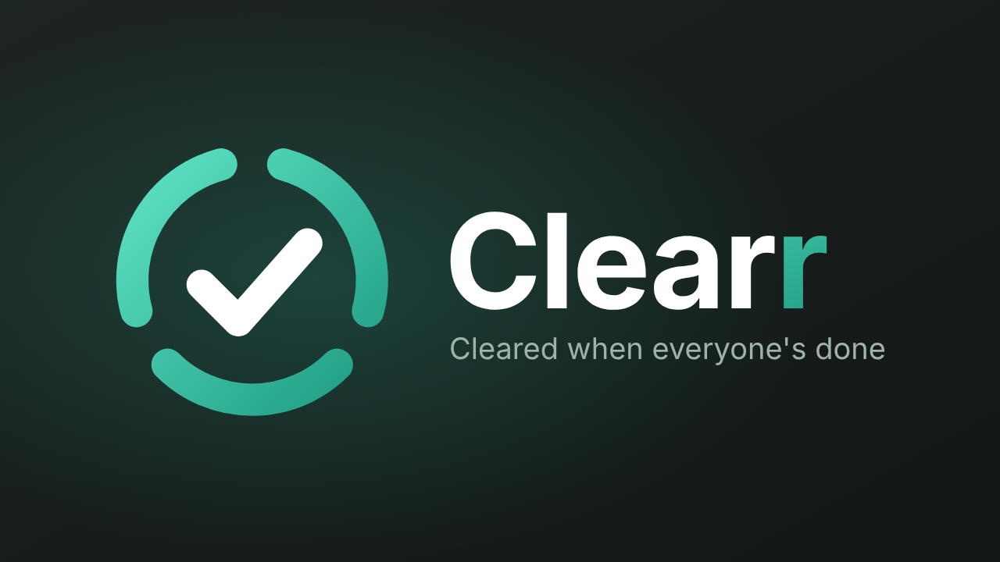
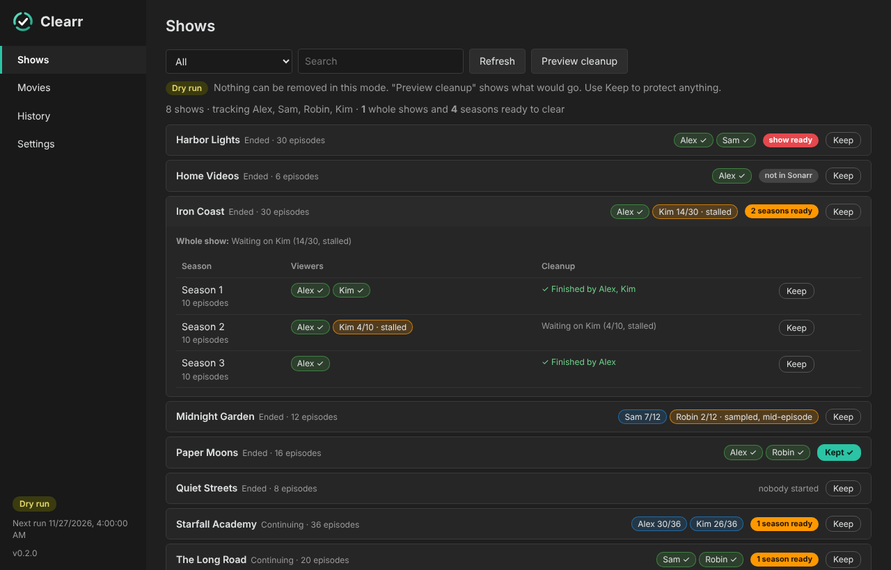
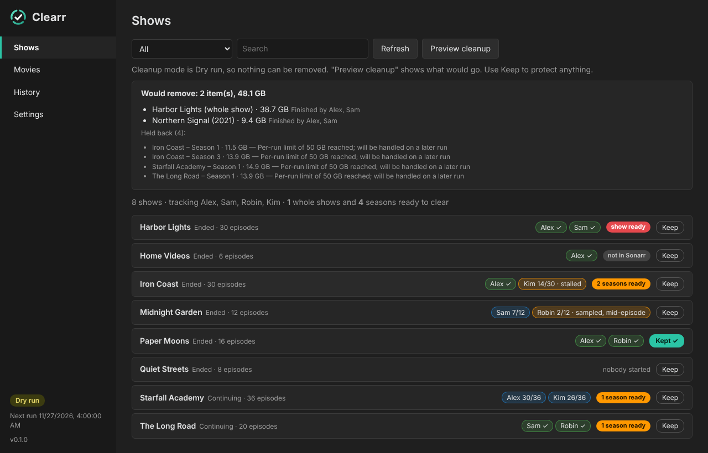
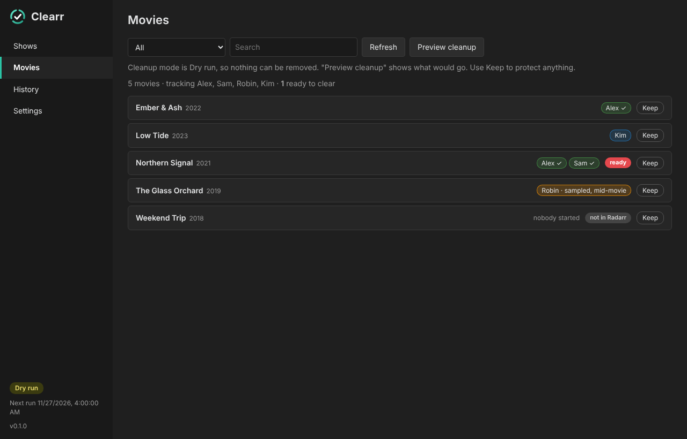
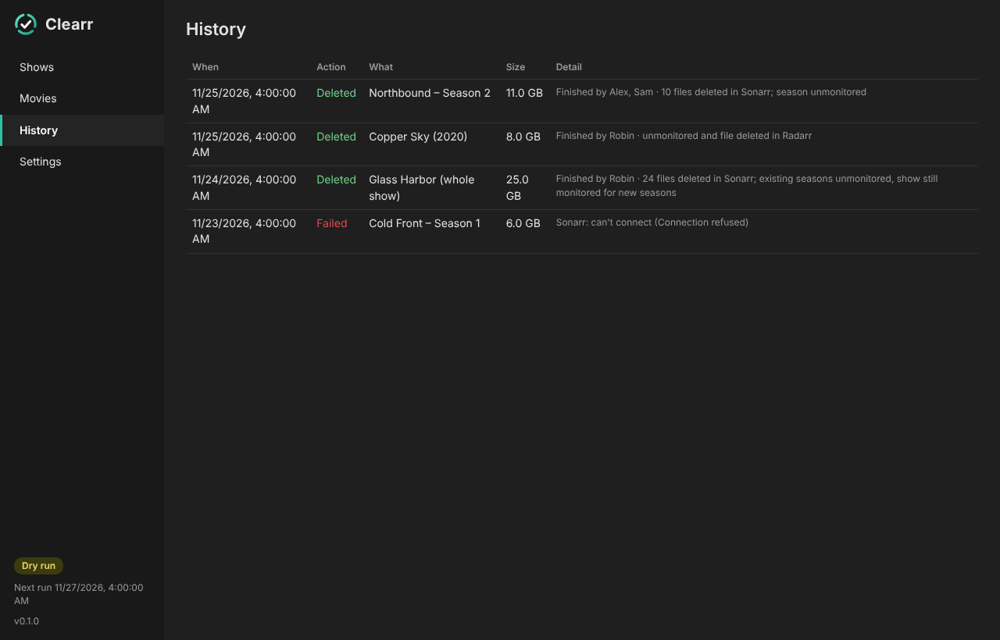
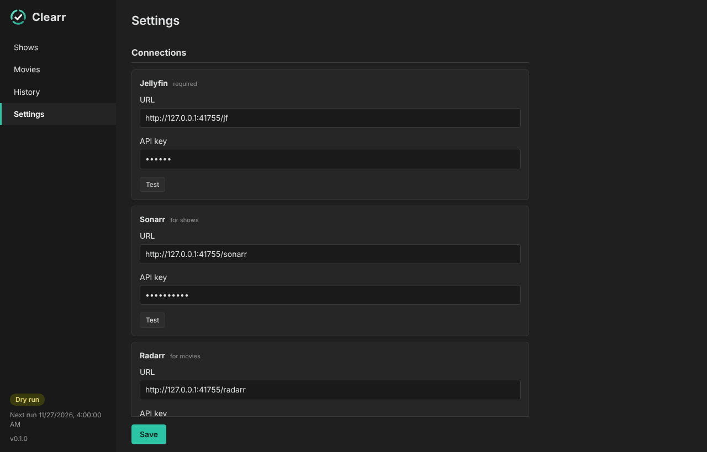
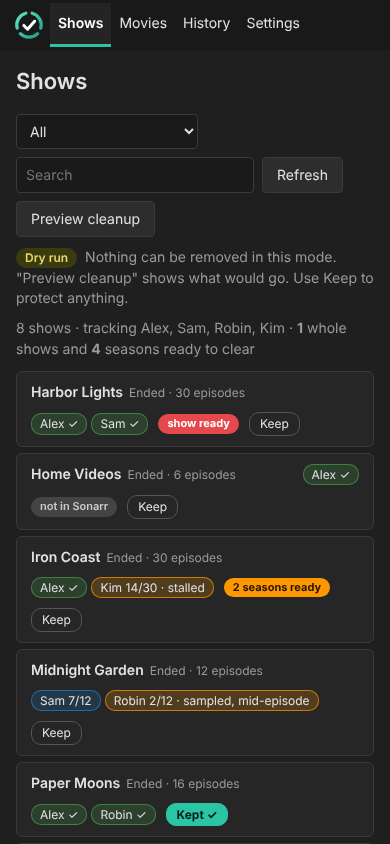

# Clearr

[](https://github.com/samuelcomplex/clearr/actions/workflows/build.yml)
[](https://github.com/samuelcomplex/clearr/actions/workflows/compatibility.yml)



**Clearr clears a show, season or movie once everyone who started watching it has finished.**

Most cleanup tools decide by rules: last watched date, age, disk space. Clearr is built for shared households. It follows each Jellyfin user separately and waits until *every person who started* something has finished it. It also spots people who quietly dropped off, so one forgotten half-watched episode doesn't block cleanup forever (unless you want it to).

It's a companion to the *arr stack. **Sonarr and Radarr delete the files.** Clearr tells them what's done, unmonitors it so it isn't downloaded again, and keeps shows monitored so new seasons still arrive.



## Features

- **Per-person progress** for every show, season and movie: *Not started*, *In progress* or *Finished*, straight from Jellyfin's own watched and resume data. Existing history counts from day one.
- **Dropped-off viewers** are flagged: **Sampled** (watched only a few episodes), **Stalled** (got partway, then stopped) and **Mid-episode** (stopped in the middle).
- **Clears through Sonarr and Radarr**: a finished season, a whole show (once it has Ended), or a finished movie.
- **Safe by default**: starts in Dry run, previews with sizes, has a per-run size limit, never touches files Jellyfin hasn't seen yet, and keeps a full history.
- **Keep** anything with one click. It's mirrored as a `keep` tag in Sonarr/Radarr, and a `keep` tag set in Jellyfin, Sonarr or Radarr works too.
- **Web UI for everything**: connections (with Test buttons), schedule, rules, users and password. There are no config files to edit.
- Works on desktop and mobile. Optional password, optional **HTTPS** (your own certificate or a self-signed one), and an *arr-style API key.

## Install

### Docker Compose / Portainer stack

```yaml
services:
  clearr:
    image: ghcr.io/samuelcomplex/clearr:latest
    container_name: clearr
    environment:
      - TZ=Europe/Stockholm      # the daily run uses this time zone
    volumes:
      - ./clearr:/config         # settings, keep list and history
      # - /path/to/certs:/certs:ro   # only if you use your own HTTPS certificate
    ports:
      - 8585:8585                # web UI (HTTP)
      # - 8586:8586              # HTTPS, if enabled in Settings
    restart: unless-stopped      # also lets "Restart Clearr" in Settings work
```

In Portainer: **Stacks → Add stack**, paste the above, and **Deploy**. Then open `http://<server>:8585`.

Clearr needs **no access to your media folders**. Everything goes through the Jellyfin, Sonarr and Radarr APIs.

### First run

1. Open **Settings → Connections** and fill in:
   - **Jellyfin**: URL and an API key (*Jellyfin Dashboard → API Keys → +*)
   - **Sonarr** and/or **Radarr**: URL and API key (*Settings → General → API Key*)

   Click **Test** on each, then **Save**.
2. Open **Shows** and **Movies** to see everyone's progress.
3. Leave it in **Dry run** for a week or so. The History tab shows what *would* have been cleared each night. Click **Keep** on anything you want to hold onto.
4. When the dry-run list looks right, set **Cleanup mode** to **Delete**.

### HTTPS (optional)

If a reverse proxy like Nginx Proxy Manager already serves Clearr over HTTPS, you don't need this. Otherwise, go to **Settings → HTTPS**:

1. Tick **Enable HTTPS**. The port defaults to **8586**; map it in Docker too (`8586:8586`).
2. Choose a certificate, or leave the path empty for a **self-signed** one that Clearr creates and keeps in `/config`. Accepted formats:
   - **PEM** certificate + key, such as Let's Encrypt's `fullchain.pem` + `privkey.pem`
   - **.pfx/.p12**, optionally with a password

   Mount the certificate folder into the container read-only, for example `- /path/to/certs:/certs:ro`, and use paths like `/certs/fullchain.pem`.
3. Click **Check certificate**, then **Save** and **Restart Clearr**. The restart needs `restart: unless-stopped`.

Plain HTTP stays on 8585. If the certificate can't be loaded at startup, Clearr logs why, keeps running on HTTP, and shows the error in Settings.

## How it decides

| Status | Meaning |
|---|---|
| **Not started** | Nothing played or partly played |
| **In progress** | Some played, not all |
| **Finished** | Every episode (or the movie) is marked played |

A viewer who is *In progress* with no progress for **30 days** is flagged: **Sampled** if they watched **3 or fewer** episodes, otherwise **Stalled**. **Mid-episode** is added if they stopped partway through.

**A season is cleared when all of these are true:**

- at least one person started it
- everyone who started it has finished it. Dropped-off viewers count as "not finished" unless you untick *Dropped-off viewers still hold back cleanup*.
- the **grace period** (default 7 days) has passed since the last person finished
- neither the season nor the show is kept
- it isn't the **newest season of a show that's still Continuing**, so a season that's still airing is never removed
- Sonarr manages the show

**A whole show** follows the same rules across all its seasons, and by default must be **Ended**. Continuing shows only lose finished seasons.

**A movie** is cleared when everyone who started it has finished it, after the grace period, if Radarr manages it.

## Safety

- **Nothing is removed unless Cleanup mode is Delete.** That applies to the nightly run and the *Delete eligible now* button, which only appears in Delete mode. The server refuses deletion requests in any other mode.
- **Preview cleanup** lists every item with its size (as reported by Sonarr/Radarr) and a total. *Delete eligible now* shows the same list again for you to confirm.
- **Max GB per run** (default 50). Anything over the limit waits for the next night.
- **Unmonitor before delete.** If unmonitoring fails, nothing is deleted.
- **New-download guard.** If Sonarr has more files in a season than Jellyfin knows episodes (for example an episode that just downloaded), that season is skipped until Jellyfin catches up.
- **History** records every removal, dry-run hit, skip and failure, with sizes.



## What happens in Sonarr and Radarr

| Cleared | Sonarr / Radarr |
|---|---|
| A season | That season is unmonitored, then its episode files are deleted. The show stays monitored. |
| A whole show | All existing seasons are unmonitored, then all episode files are deleted. **The show stays monitored**, so new seasons still download (if its *Monitor New Seasons* is *All*). |
| A movie | The movie is unmonitored, then its file is deleted. |

Shows or movies that Sonarr/Radarr don't manage are listed as *not in Sonarr/Radarr* and are never removed.

## Keep

Click **Keep** on a show, season or movie. Kept items are never removed.

- Keeping a show or movie also adds the `keep` tag in Sonarr/Radarr. Removing the keep removes the tag.
- A `keep` tag added in Sonarr, Radarr or Jellyfin is respected too. The tag name is configurable.
- Keeping one season blocks the whole show from being removed, but its other seasons can still be cleared.

## More screenshots

| Movies | History |
|---|---|
|  |  |

| Settings | Mobile |
|---|---|
|  |  |

*The screenshots use a made-up household from `tools/Demo`.*

## API

Every page in the UI uses a small JSON API under `/api`, for example `GET /api/report`, `POST /api/cleanup?dryRun=true` and `GET /api/history`. When a password is set, send the API key shown in **Settings → Security** as an `X-Api-Key` header. `GET /ping` is open, for health checks.

## Compatibility

| | Tested every week |
|---|---|
| Jellyfin | 10.11 and latest (12.x), plus `unstable` as an early warning |
| Sonarr | latest (v4), plus `develop` (v5) as an early warning |
| Radarr | latest, plus `develop` as an early warning |

The [compatibility check](.github/workflows/compatibility.yml) runs a **real end-to-end test**. It starts actual Jellyfin, Sonarr and Radarr containers that share a folder of generated video files, marks a season and a movie as watched, lets Clearr preview and clean up, and then checks *on disk* that exactly the right files were removed and that the right things were unmonitored. If it fails, it opens a GitHub issue.

## Development

```
dotnet run --project src/Clearr                 # http://localhost:8585 (CLEARR_PORT to change), settings in ./config next to the binary
dotnet run --project tests/Clearr.Tests         # end-to-end tests against built-in fake Jellyfin/Sonarr/Radarr
dotnet run --project tools/Demo                 # demo household on http://127.0.0.1:6567
```

Clearr is .NET 10 / ASP.NET Core with a plain HTML/JS UI and no third-party packages. Settings, the keep list and history are JSON files in `/config`.

Clearr grew out of Watch Tracker, a Jellyfin plugin. That plugin is now [Clearr for Jellyfin](https://github.com/samuelcomplex/clearr-plugin): it is built from this repo's Clearr.Core, so both share the same features and updates.
